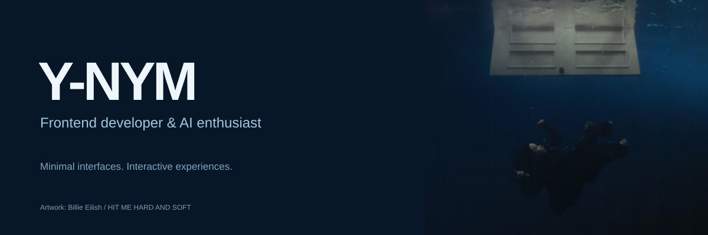

 

  

<i>don't be embarrassed to love what u love and be who u are</i>

 

## About me

I build modern, minimal and interactive web experiences with a strong interest in AI.

- **Frontend development** — clean interfaces and thoughtful details.
- **Currently learning** — React, Next.js and new ways to build for the web.
- **Exploring** — AI-powered products and how AI changes software development.
- **Open to opportunities** where I can contribute, experiment and grow.

 

## Tech stack

 

## On repeat

<table width="100%">
<tr>
<td width="140">

</td>
<td>
Now playing  
<a href="https://open.spotify.com/search/Billie%20Eilish%20CHIHIRO"><b>CHIHIRO</b></a> 
Billie Eilish  

</td>
</tr>
</table>

### Favorite tracks

<table>
  <tr>
    <td width="50%">
      
      &nbsp; <a href="https://open.spotify.com/search/Billie%20Eilish%20CHIHIRO"><b>CHIHIRO</b></a> 
      &nbsp; Billie Eilish
    </td>
    <td width="50%">
      
      &nbsp; <a href="https://open.spotify.com/search/Billie%20Eilish%20L%27AMOUR%20DE%20MA%20VIE"><b>L'AMOUR DE MA VIE</b></a> 
      &nbsp; Billie Eilish
    </td>
  </tr>
  <tr>
    <td width="50%">
      
      &nbsp; <a href="https://open.spotify.com/search/Lana%20Del%20Rey%20Say%20Yes%20To%20Heaven"><b>Say Yes To Heaven</b></a> 
      &nbsp; Lana Del Rey
    </td>
    <td width="50%">
      
      &nbsp; <a href="https://open.spotify.com/search/Lana%20Del%20Rey%20National%20Anthem"><b>National Anthem</b></a> 
      &nbsp; Lana Del Rey
    </td>
  </tr>
  <tr>
    <td width="50%">
      
      &nbsp; <a href="https://open.spotify.com/search/Mitski%20First%20Love%20Late%20Spring"><b>First Love / Late Spring</b></a> 
      &nbsp; Mitski
    </td>
    <td width="50%">
      
      &nbsp; <a href="https://open.spotify.com/search/Mitski%20A%20Pearl"><b>A Pearl</b></a> 
      &nbsp; Mitski
    </td>
  </tr>
  <tr>
    <td width="50%">
      
      &nbsp; <a href="https://open.spotify.com/search/%D0%9C%D0%BE%D0%BD%D0%B5%D1%82%D0%BE%D1%87%D0%BA%D0%B0%20%D0%9F%D0%B0%D0%BF%D0%B8%D0%BD%D0%B0%20%D0%BB%D1%8E%D0%B1%D0%BE%D0%B2%D0%BD%D0%B8%D1%86%D0%B0"><b>Папина любовница</b></a> 
      &nbsp; Монеточка
    </td>
    <td width="50%">
      
      &nbsp; <a href="https://open.spotify.com/search/%D0%9C%D0%BE%D0%BD%D0%B5%D1%82%D0%BE%D1%87%D0%BA%D0%B0%20%D0%9A%D0%B0%D0%B6%D0%B4%D1%8B%D0%B9%20%D1%80%D0%B0%D0%B7"><b>Каждый раз</b></a> 
      &nbsp; Монеточка
    </td>
  </tr>
</table>

  
More tracks

<b>Billie Eilish</b> 
<a href="https://open.spotify.com/search/Billie%20Eilish%20CHIHIRO">CHIHIRO</a> · <a href="https://open.spotify.com/search/Billie%20Eilish%20BITTERSUITE">BITTERSUITE</a> · <a href="https://open.spotify.com/search/Billie%20Eilish%20L%27AMOUR%20DE%20MA%20VIE">L'AMOUR DE MA VIE</a> · <a href="https://open.spotify.com/search/Billie%20Eilish%20L%27AMOUR%20DE%20MA%20VIE%20%5Bover%20now%5D">L'AMOUR DE MA VIE [over now]</a> · <a href="https://open.spotify.com/search/Billie%20Eilish%20everybody%20dies">everybody dies</a> · <a href="https://open.spotify.com/search/Billie%20Eilish%20Your%20Power">Your Power</a>  

<b>Lana Del Rey</b> 
<a href="https://open.spotify.com/search/Lana%20Del%20Rey%20National%20Anthem">National Anthem</a> · <a href="https://open.spotify.com/search/Lana%20Del%20Rey%20Say%20Yes%20To%20Heaven">Say Yes To Heaven</a> · <a href="https://open.spotify.com/search/Lana%20Del%20Rey%20Doin%27%20Time">Doin' Time</a> · <a href="https://open.spotify.com/search/Lana%20Del%20Rey%20Music%20To%20Watch%20Boys%20To">Music To Watch Boys To</a> · <a href="https://open.spotify.com/search/Lana%20Del%20Rey%20White%20Mustang">White Mustang</a>  

<b>Mitski</b> 
<a href="https://open.spotify.com/search/Mitski%20A%20Pearl">A Pearl</a> · <a href="https://open.spotify.com/search/Mitski%20I%20Bet%20on%20Losing%20Dogs">I Bet on Losing Dogs</a> · <a href="https://open.spotify.com/search/Mitski%20First%20Love%20%2F%20Late%20Spring">First Love / Late Spring</a>  

<b>Монеточка</b> 
<a href="https://open.spotify.com/search/%D0%9C%D0%BE%D0%BD%D0%B5%D1%82%D0%BE%D1%87%D0%BA%D0%B0%20%D0%9F%D0%B0%D0%BF%D0%B8%D0%BD%D0%B0%20%D0%BB%D1%8E%D0%B1%D0%BE%D0%B2%D0%BD%D0%B8%D1%86%D0%B0">Папина любовница</a> · <a href="https://open.spotify.com/search/%D0%9C%D0%BE%D0%BD%D0%B5%D1%82%D0%BE%D1%87%D0%BA%D0%B0%20%D0%9A%D0%B0%D0%B6%D0%B4%D1%8B%D0%B9%20%D1%80%D0%B0%D0%B7">Каждый раз</a> · <a href="https://open.spotify.com/search/%D0%9C%D0%BE%D0%BD%D0%B5%D1%82%D0%BE%D1%87%D0%BA%D0%B0%20%D0%9D%D0%B8%D0%BC%D1%84%D0%BE%D0%BC%D0%B0%D0%BD%D0%BA%D0%B0">Нимфоманка</a> · <a href="https://open.spotify.com/search/%D0%9C%D0%BE%D0%BD%D0%B5%D1%82%D0%BE%D1%87%D0%BA%D0%B0%20%D0%9C%D0%BE%D0%BD%D0%BE%D0%BF%D0%BE%D0%BB%D0%B8%D1%8F">Монополия</a>  

 

## GitHub activity

 

<i>your face is a reflection of the love of two people who wanted to become something more for each other</i>

  

building things, exploring ideas, and trying to make the web a little more beautiful.

  

